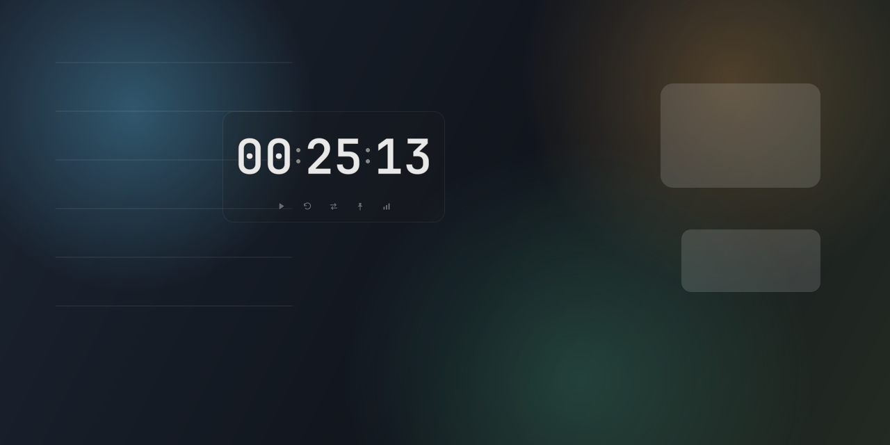

# XTime

一个使用 Python + PySide6 编写的 Windows 桌面计时器，支持倒计时、正计时与累计时长统计。

## 项目展示

**GIF 演示（预留）**

<p align="center"><i>将演示 GIF 放到 docs/images/XTime-demo.gif 后，取消下方注释</i></p>

<!--
<p align="center">
  
</p>
-->

**界面截图**

<!-- 替换 docs/images/XTime-main.png 与 XTime-transparent.png 即可更新截图 -->
<p align="center">
  
</p>

<p align="center">
  
</p>

## 功能特性

- **倒计时**：支持 `00:00:01` ~ `23:59:59`，归零后弹出提示并可选提示音
- **正计时**：从 `00:00:00` 开始向上累计，不设上限
- **开始 / 暂停 / 重置**：重置清空当前计时，不影响累计统计
- **模式切换**：倒计时 ⇄ 正计时；正在计时时切换会先确认并结束当前会话
- **累计统计**：按秒记录会话，支持今日 / 本周 / 本月 / 今年 / 历史总计，倒计时与正计时分开统计
- **窗口外观**：无边框、圆角、半透明，支持淡灰透明与纯透明两种背景
- **背景调节**：淡灰模式可调透明度，可选轻量亚克力磨砂；纯透明模式不绘制底色
- **字体与颜色**：时间数字强制粗体，数字颜色、冒号颜色可自定义
- **数字切换**：数字直接替换，不做翻页或 3D 动画；冒号与秒同步闪烁
- **窗口操作**：拖动时间区移动，滚轮 `0.6×` ~ `2.0×` 缩放，位置与比例持久化
- **始终置顶**：小按钮或右键菜单切换
- **绿色便携**：单文件 `data.json`，解压双击 `XTime.exe` 即可运行

## 技术栈

**语言**
- `Python 3.12`

**界面**
- `PySide6 6.8.3`
- `Qt Widgets` / `QtSvg`

**数据**
- `json`
- `pathlib`

**打包**
- `PyInstaller 6.22.3`
- `onedir` 绿色便携版

**字体**
- `JetBrains Mono`（SIL Open Font License 1.1）

## 运行方式

### 直接运行

解压 `XTime-win64.zip`，双击 `XTime.exe` 即可，无需安装。

### 源码运行

```powershell
python -m venv .venv
.\.venv\Scripts\python.exe -m pip install -r requirements.txt
.\.venv\Scripts\python.exe main.py
```

### 打包

```powershell
powershell.exe -NoProfile -ExecutionPolicy Bypass -File build\build.ps1
```

打包脚本会生成 `dist/XTime/` 和 `XTime-win64.zip`。

## 操作说明

1. **开始 / 暂停**：点击按钮或按 `空格`
2. **重置**：点击重置按钮或按 `R`
3. **切换模式**：点击模式按钮或按 `M`
4. **设置倒计时**：倒计时模式下点击时间区
5. **移动窗口**：拖动时间区
6. **缩放窗口**：鼠标悬停后滚动滚轮
7. **背景 / 颜色 / 字体**：右键打开菜单
8. **统计 / 数据目录**：右键菜单中打开

**快捷键**

- `空格`：开始 / 暂停
- `R`：重置
- `T`：始终置顶
- `M`：倒计时 / 正计时切换
- `C`：颜色面板
- `Ctrl+↑` / `Ctrl+↓`：放大 / 缩小

## 数据结构与存放位置

### 存放位置

默认保存在程序同级目录：

```text
<XTime.exe 所在目录>\data.json
```

如果该目录不可写（例如放在 `C:\Program Files`），自动回退到：

```text
%APPDATA%\XTime\data.json
```

首次使用兜底路径时会提示实际位置；右键菜单「打开数据文件夹」可直接定位。

### 数据结构

```json
{
  "version": 1,
  "sessions": [
    {
      "id": "uuid",
      "mode": "countdown",
      "start": "2026-10-19T10:00:00+08:00",
      "end": "2026-10-19T10:25:00+08:00",
      "duration_seconds": 1500
    }
  ],
  "settings": {
    "last_mode": "countdown",
    "last_countdown": "00:25:00",
    "always_on_top": false,
    "window_pos": [200, 300],
    "window_scale": 1.0,
    "background_style": "faint_gray",
    "background_alpha": 0.18,
    "font_family": "JetBrains Mono",
    "font_weight": 700,
    "font_color": "#E8E8E8",
    "colon_color": "#888888",
    "colon_follow_digit": false,
    "blur_enabled": false,
    "sound_enabled": true,
    "confirm_on_exit": true,
    "fallback_notice_shown": false
  }
}
```

- `sessions`：每次从开始到暂停/结束的会话记录
- `duration_seconds`：实际经过的秒数，不保存倒计时剩余时间
- `start` / `end`：带时区的 ISO 8601 时间
- `settings`：上次模式、倒计时时长、窗口位置/缩放、背景、字体颜色等
- 运行中每 30 秒落盘一次；暂停、重置、归零、退出时立即保存
- 会话按开始时间归入今日 / 本周 / 本月 / 今年；跨午夜会话归入开始那天
- 数据可直接手改；JSON 损坏时会备份为 `data.json.broken-<时间戳>` 并重建

## 字体许可

随包字体为 [JetBrains Mono](https://github.com/JetBrains/JetBrainsMono)，使用 SIL Open Font License 1.1。完整许可见 [THIRD_PARTY_LICENSES.txt](THIRD_PARTY_LICENSES.txt) 与 `app/assets/fonts/OFL.txt`。
